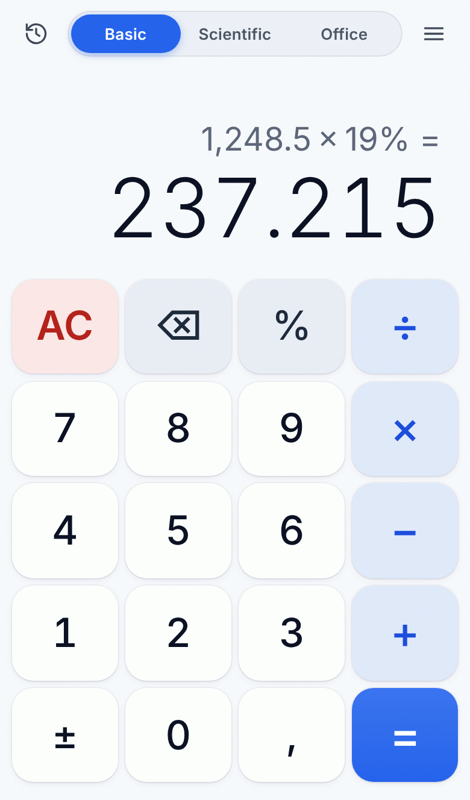
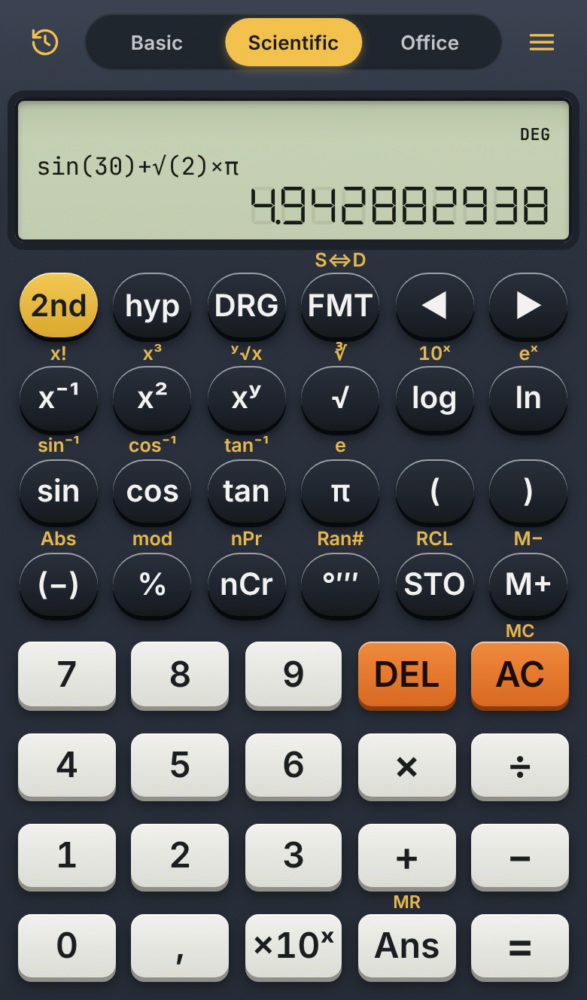
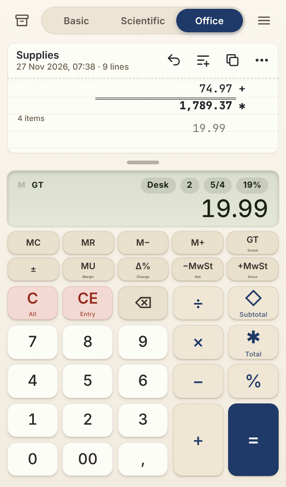
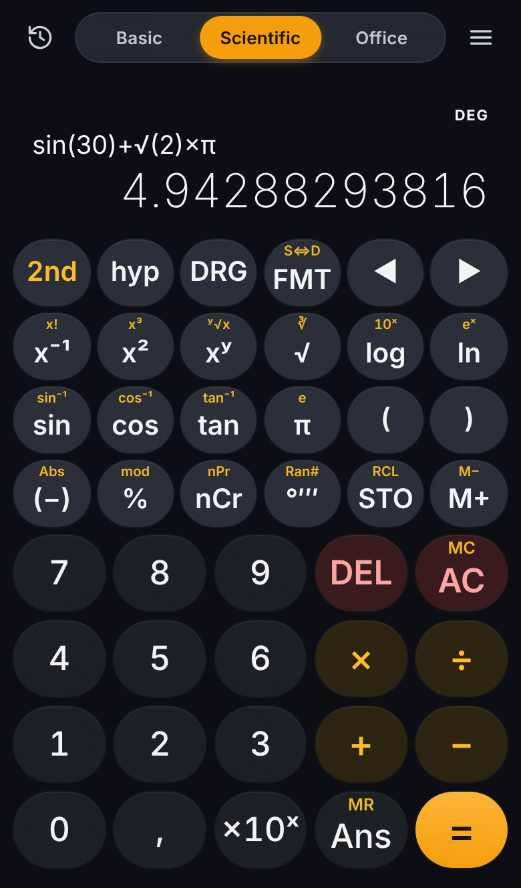
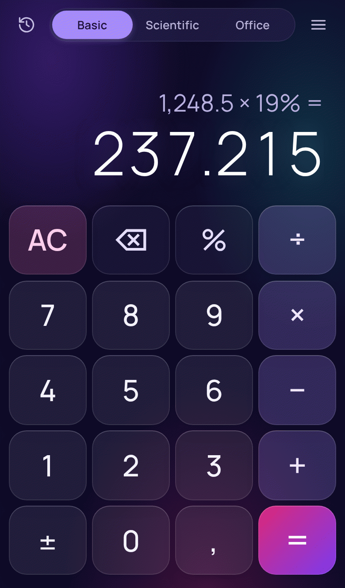
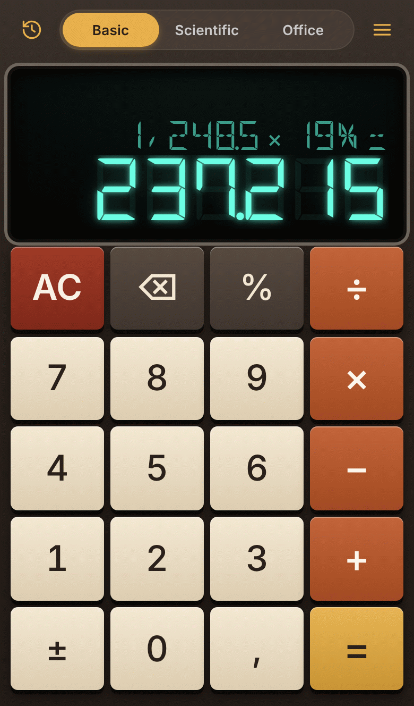
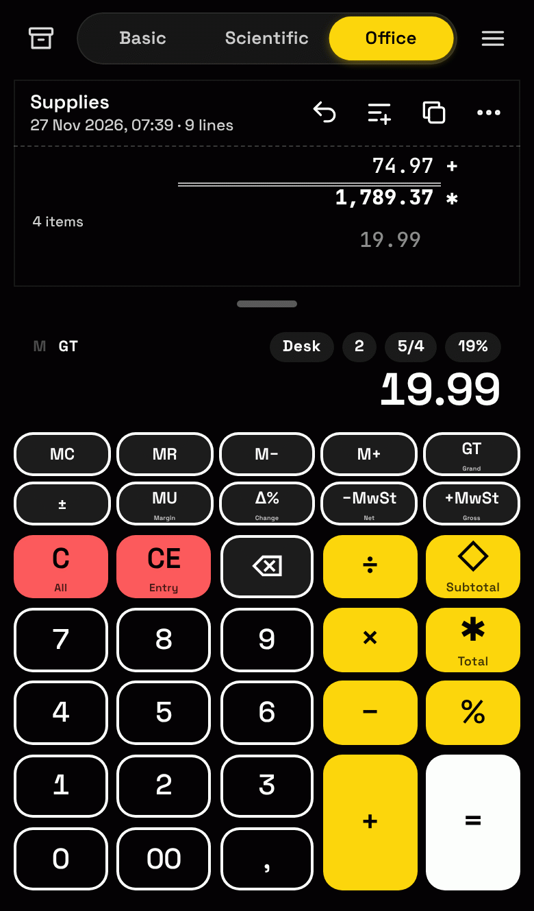
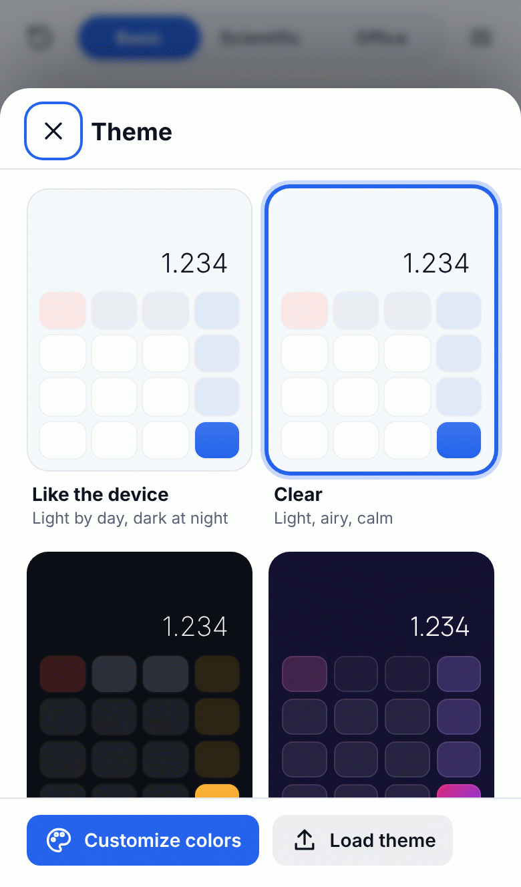
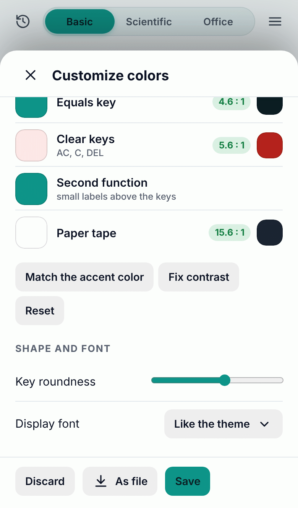
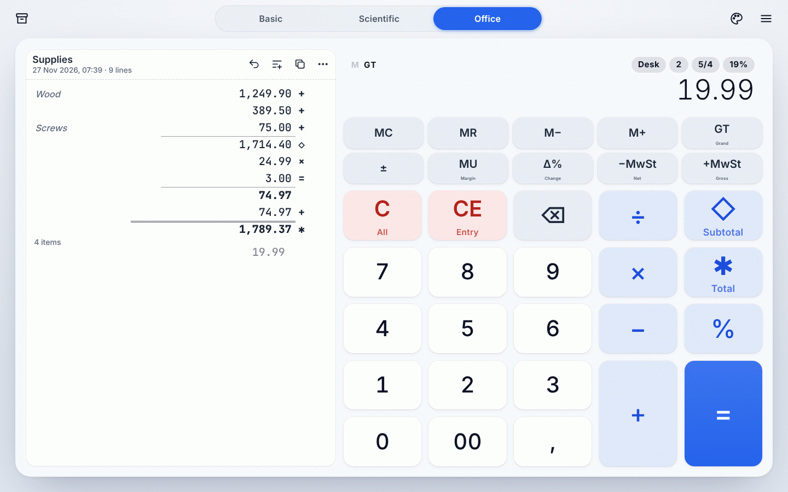

# Calc

[Deutsch](README.md) · **English**

**[⬇️ Download the latest release](../../releases/latest)** · **[☕ Buy me a coffee](https://ko-fi.com/burnersen)**

A calculator with three modes: **Basic** for quick everyday sums, **Scientific** like the school calculator you remember, and **Office**, a desk calculator with a running paper tape. Seven themes, your own colors, German and English.

Calc is an installable web app (PWA). Open it once and everything is stored on the device, after that Calc runs **completely without internet**, for good. There is no server, no account, no database. Everything you save stays in your browser. Plain JavaScript and CSS, no frameworks, no dependencies, no build step, nothing is loaded from third-party servers.

Upload `calc-install.php`, open it in the browser, done. Or unpack the ZIP and upload it, which works on any web space, even without PHP.

  
  
  

<table>
  <tr>
    <td align="center" width="33%"> Night: deep dark with amber</td>
    <td align="center" width="33%"> Aurora: northern lights behind glass</td>
    <td align="center" width="33%"> Retro: glowing digits in a wooden case</td>
  </tr>
  <tr>
    <td align="center"> Contrast: maximum legibility</td>
    <td align="center"> Choose a theme</td>
    <td align="center"> Color mixer with contrast check</td>
  </tr>
</table>

Screenshots of version 1.0.1. The calculations are made up.

## The three modes

Switch modes at the top by tapping, by swiping across the switcher or with <kbd>Alt</kbd>+<kbd>1</kbd>, <kbd>2</kbd>, <kbd>3</kbd> on a computer. Every mode keeps its own state.

### Basic

- Clean, large keys, large display. While typing the calculation is shown large with the result faintly below, after “=” they swap places.
- **Operator precedence:** 2 + 3 × 4 = 14. **Percent like a pocket calculator:** 200 + 10 % = 220, 200 − 10 % = 180.
- **“=” again** repeats the last operation: 5 + 3 = = = gives 8, 11, 14.
- **Exact:** 0.1 + 0.2 is 0.3, not 0.30000000000000004. Calc uses real decimal numbers, division to 40 digits.
- **History** of all calculations.

### Scientific

Modelled on classic school calculators: calculation with cursor on top, result below, second functions printed above each key.

- sin, cos, tan and inverses, **hyp** for sinh, cosh, tanh, **DEG / RAD / GRAD**. sin 30° is exactly 0.5, sin 180° exactly 0.
- x², x³, xʸ, √, ∛, ʸ√x, x⁻¹, 10ˣ, eˣ, ×10ˣ, log, ln, factorial, nCr, nPr, mod, absolute value, random number.
- π, e, **Ans**, **M+ / M− / MR / MC**, memories **A to F** (STO, RCL).
- Results as a **fraction** (S⇔D) or in **degrees, minutes, seconds**. Number formats Normal, FIX, SCI, ENG.
- Like a school calculator: 2π and 2(3+4) work without a times sign, and implied multiplication goes first (switchable). −2² is −4. Pressing “=” again repeats the calculation with the new Ans.

### Office: desk calculator with paper tape

- **Two logics, switchable:** **adding machine logic** (number, then + or −, ◇ subtotal, ✱ total, GT grand total, item counter) or **normal logic** (12 + 5 × 2 = 34, step by step).
- **Decimals** F, 0 to 4 or **ADD** (automatic cents), **rounding** half up, up or truncate.
- **+Tax / −Tax** with your tax rate, **MU** (markup on margin), **Δ%** (percent change), markup and discount with %, memory keys, 00 or 000.
- **The tape:** negatives in red, rules under subtotals and totals. Tap a line to add a note, **correct the value (everything after it is recalculated)**, bring it into the display, copy or delete it. Note lines, a name for the tape, unlimited undo.
- **Copy, share, save, print:** as aligned text, as a spreadsheet (CSV) or on paper. **New tape** moves the old one to the **archive**.
- Portrait phones show the tape on top (drag to resize), landscape, tablets and computers next to the keys.

## Look and feel

- **Seven themes** that differ in shape, shadow and type, not just color: **Clear**, **Night**, **Aurora**, **School calculator** (greenish LCD with 7-segment digits and faint unlit segments, solar cell, golden second functions; an original design, not a copy of any particular model), **Retro** (glowing digits behind black glass), **Paper** and **Contrast**. **Like the device** follows light and dark mode.
- Every key label has at least 4.5:1 contrast, the display 7:1, checked by an automated test.
- **Color mixer:** recolor accent, background, case, display, every key group, second-function labels and the tape, live on the real calculator, with a contrast badge per row, automatic text colors, “Fix contrast” and “Match the accent color”. Save as many own themes as you like, export and import them as files.
- Keys react on touch with visible feedback, optional vibration and click. **No keyboard pops up unexpectedly:** there is no input field you did not open yourself.
- Full keyboard support on computers, press <kbd>?</kbd> for all shortcuts.

## Offline and as an app

- **Loading once is enough.** On the first visit Calc stores every file on the device. After that it starts in airplane mode, for good.
- **Install** via “Add to Home Screen” (iPhone, iPad), “Install app” (Android) or the install icon in the address bar (Chrome, Edge) or “Add to Dock” (Safari on Mac). The settings contain instructions for your device.
- **Updates arrive by themselves** when online, Calc asks before reloading so no calculation gets lost.
- **Your data stays on the device.** Use **Backup** in the settings to move to another device.

## Installation

Calc only needs web space with **HTTPS**. No PHP, no database.

- **Installer** (needs PHP 7.0+): upload `calc-install.php` from the [latest release](../../releases/latest), open it in the browser, click “Install now”. It writes `index.html`, `sw.js`, `manifest.webmanifest` and `app/`, checks every file and deletes itself.
- **By hand:** unpack `calc-<version>.zip` and upload the contents of the `calc/` folder.
- **Try locally:** `php -S localhost:8000` or `python3 -m http.server` in the folder, then open `http://localhost:8000`.

To update, upload the new installer or ZIP. Users get the new version the next time they open Calc, their data stays on their devices.

Build it yourself: `php tools/build-release.php`, see [BUILD.md](BUILD.md).

## Disclaimer

Calc is free hobby software provided **as is, without any warranty**. Please double-check results for important calculations. See sections 15 and 16 of the [license](LICENSE).

## License

GNU Affero General Public License v3.0, see [LICENSE](LICENSE). The fonts are under the SIL Open Font License 1.1, see `app/fonts/`.
