# Calc

**Deutsch** · [English](README.en.md)

[](#offline-und-als-app)
[](#lizenz)
[](https://ko-fi.com/burnersen)

**[⬇️ Neuestes Release herunterladen](../../releases/latest)** · **[☕ Spendier mir einen Kaffee](https://ko-fi.com/burnersen)**

Ein Taschenrechner mit drei Modi: **Einfach** für schnell zwischendurch, **Wissenschaftlich** wie der Schulrechner von früher und **Büro** als Tischrechner mit mitlaufendem Papierstreifen. Sieben Designs, eigene Farben, Deutsch und Englisch.

Calc ist eine Web-App zum Installieren (PWA). Einmal geöffnet, liegt alles auf dem Gerät, und Calc läuft danach **komplett ohne Internet**, dauerhaft. Es gibt keinen Server, kein Konto, keine Datenbank. Alles, was du speicherst, bleibt in deinem Browser. Im Browser laufen schlichtes JavaScript und CSS, keine Frameworks, keine Abhängigkeiten, kein Build-Schritt, nichts wird von fremden Servern geladen.

`calc-install.php` hochladen, im Browser öffnen, fertig. Oder das ZIP entpacken und hochladen, das läuft auf jedem Webspace, auch ganz ohne PHP.

<p align="center">
  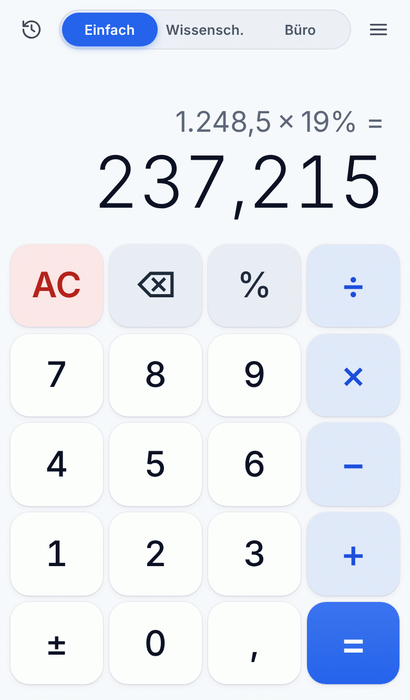
  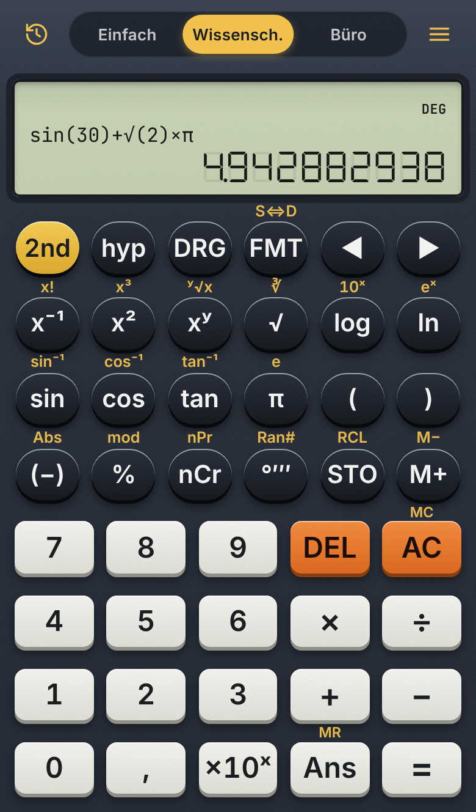
  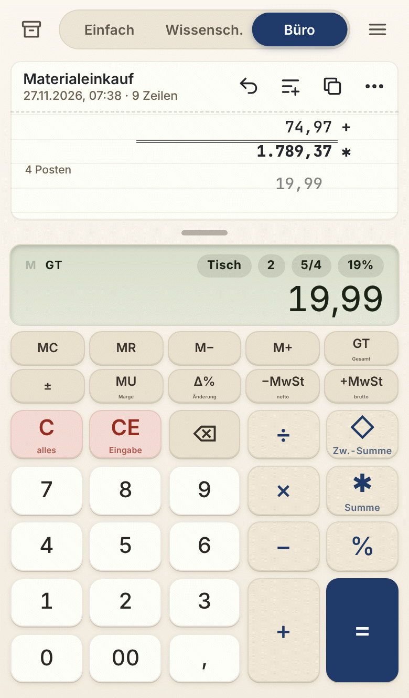
</p>

<table>
  <tr>
    <td align="center" width="33%">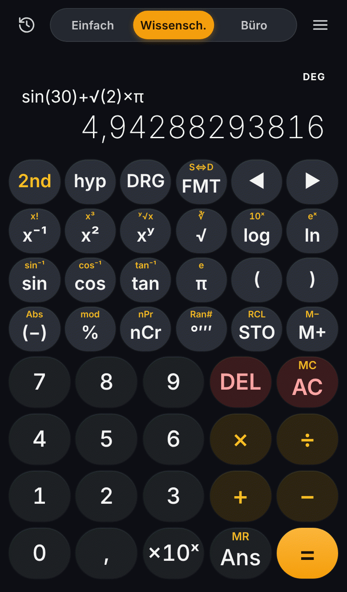<br><sub>Nacht: tiefes Dunkel mit Bernstein</sub></td>
    <td align="center" width="33%">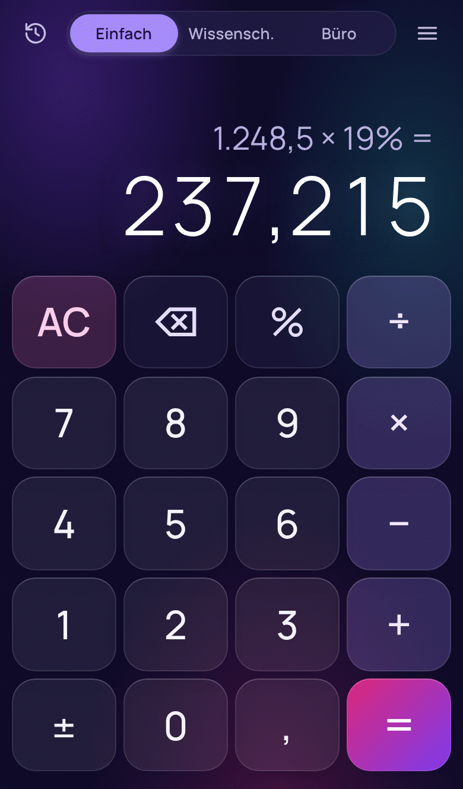<br><sub>Aurora: Nordlicht hinter Glas</sub></td>
    <td align="center" width="33%">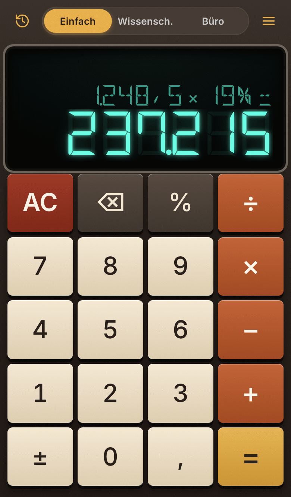<br><sub>Retro: Leuchtziffern im Holzgehäuse</sub></td>
  </tr>
  <tr>
    <td align="center">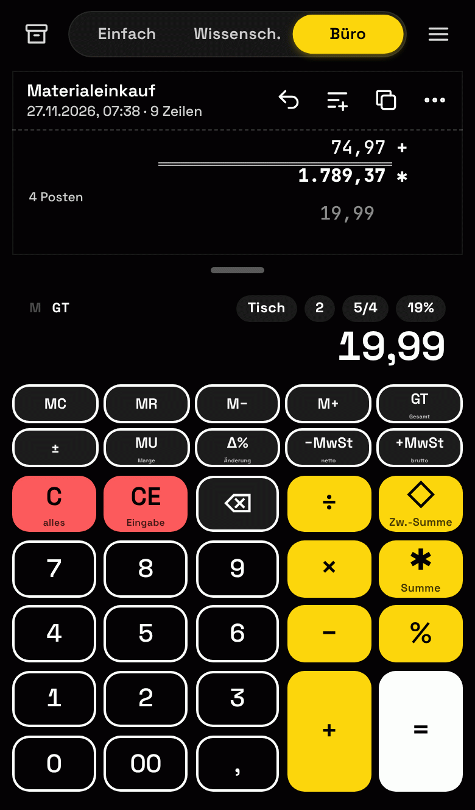<br><sub>Kontrast: maximal lesbar</sub></td>
    <td align="center">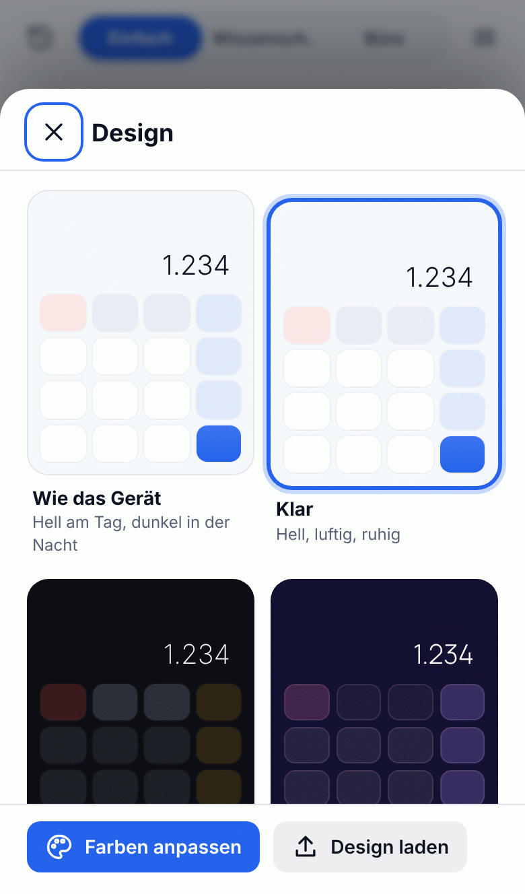<br><sub>Design aussuchen</sub></td>
    <td align="center">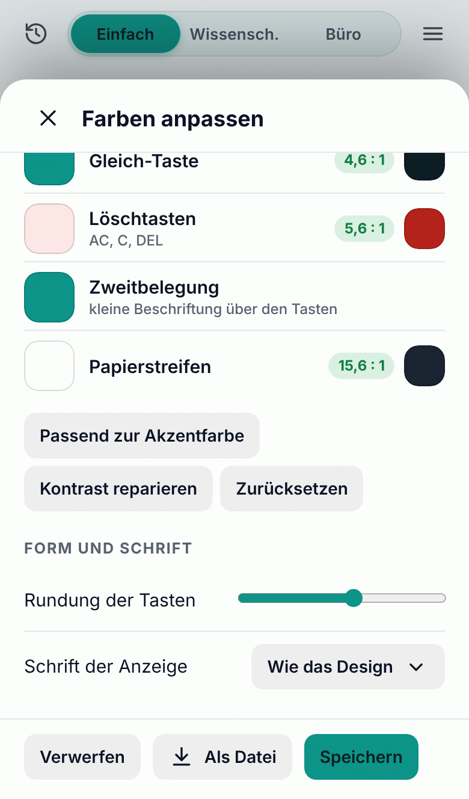<br><sub>Farbmischer mit Kontrast-Prüfung</sub></td>
  </tr>
  <tr>
    <td align="center">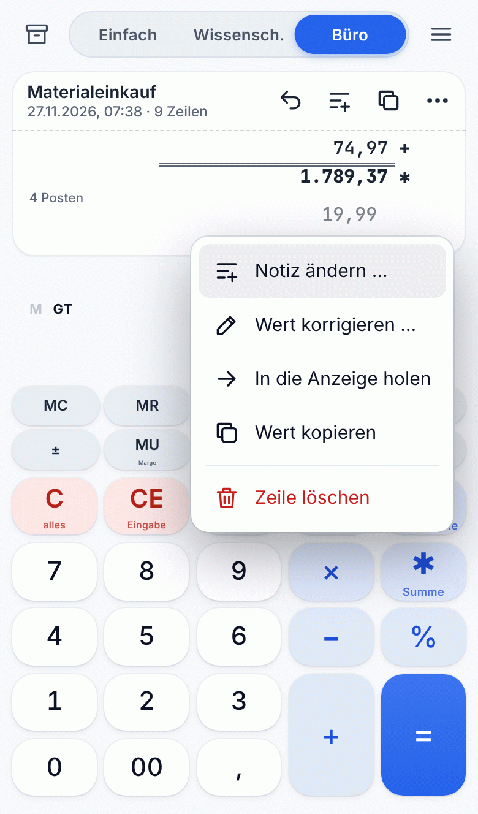<br><sub>Streifen: Zeile antippen</sub></td>
    <td align="center" colspan="2">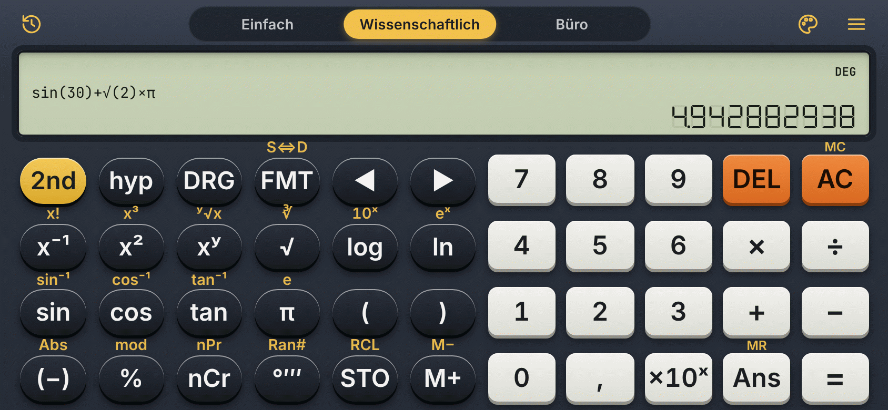<br><sub>Im Querformat liegen die Tasten nebeneinander</sub></td>
  </tr>
</table>

<p align="center">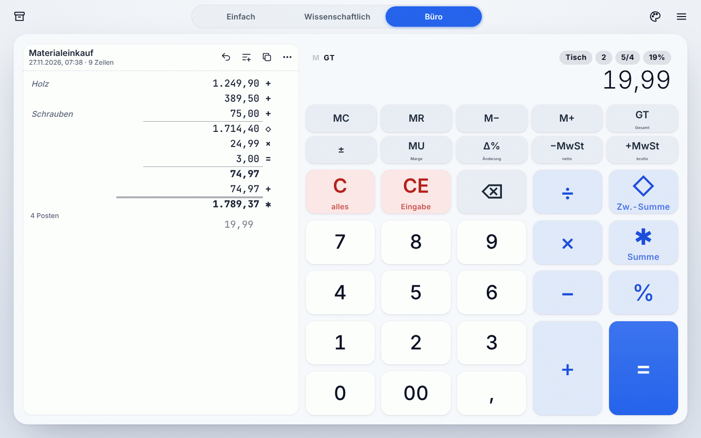<br><sub>Am Computer: Streifen links, Tischrechner rechts, alles per Tastatur bedienbar</sub></p>

<sub>Screenshots von Version 1.0.1. Die Rechnungen sind erfunden.</sub>

> 💜 **Gefällt dir Calc?** Ein ⭐ auf GitHub ist die einfachste Art, mir das zu sagen. Oder [erzähl mir, wofür du es nutzt](../../issues/new), ich lese jede Nachricht. Danke, dass du da bist!

## Inhalt

[Die drei Modi](#die-drei-modi) · [Aussehen](#aussehen) · [Bedienung](#bedienung) · [Offline und als App](#offline-und-als-app) · [Installation](#installation) · [Aktualisieren](#aktualisieren) · [Aufbau](#aufbau) · [Gut zu wissen](#gut-zu-wissen) · [Lizenz](#lizenz)

## Die drei Modi

Oben wechselst du zwischen den Modi, per Antippen, durch Wischen über den Umschalter oder am Computer mit <kbd>Alt</kbd>+<kbd>1</kbd>, <kbd>2</kbd>, <kbd>3</kbd>. Jeder Modus behält seinen eigenen Stand.

### Einfach

- Aufgeräumt, große Tasten, große Anzeige. Beim Tippen steht die Rechnung groß da, darunter blass schon das Ergebnis. Nach „=“ tauschen beide die Plätze.
- **Punkt vor Strich:** 2 + 3 × 4 = 14.
- **Prozent wie am Taschenrechner:** 200 + 10 % = 220, 200 − 10 % = 180, 200 × 10 % = 20.
- **Nochmal „=“** wiederholt die letzte Rechenart: 5 + 3 = = = ergibt 8, 11, 14.
- **Rechnet exakt:** 0,1 + 0,2 ist 0,3 und nicht 0,30000000000000004. Calc rechnet mit echten Dezimalzahlen, Geteilt auf 40 Stellen genau.
- **Verlauf** mit allen Rechnungen, Antippen übernimmt das Ergebnis.

### Wissenschaftlich

Angelehnt an die klassischen Schulrechner: oben die Rechnung mit Cursor, unten das Ergebnis, die Zweitbelegung steht klein über jeder Taste.

- **Trigonometrie:** sin, cos, tan und die Umkehrfunktionen, mit **hyp** auch sinh, cosh, tanh. Winkel in **DEG, RAD oder GRAD**. sin 30° ist genau 0,5, sin 180° genau 0, tan 90° meldet einen Fehler.
- **Potenzen und Wurzeln:** x², x³, xʸ, √, ∛, ʸ√x, x⁻¹, 10ˣ, eˣ, ×10ˣ.
- **Logarithmen:** log und ln.
- **Konstanten und Speicher:** π, e, **Ans** (letztes Ergebnis), **M+ / M− / MR / MC** und die Speicher **A bis F** (STO und RCL).
- **Mehr:** Klammern (schließen sich am Ende selbst), Fakultät, nCr, nPr, mod, Betrag, Zufallszahl, Vorzeichen (−).
- **Ergebnis anders zeigen:** als **Bruch** (S⇔D: 0,75 → ³⁄₄) oder in **Grad, Minuten, Sekunden**.
- **Zahlenformat:** Normal, feste Nachkommastellen (FIX), wissenschaftlich (SCI) oder technisch (ENG).
- **Wie am Schulrechner:** 2π und 2(3+4) gehen ohne Malzeichen, und das Mal ohne Zeichen geht vor: 1 ÷ 2π = 1 ÷ (2π). Abschaltbar in den Einstellungen. −2² ist −4. Nochmal „=“ rechnet dieselbe Rechnung mit dem neuen Ans, aus „Ans + 1 = = =“ wird ein Zähler.
- **Cursor:** mit ◀ ▶ in der Rechnung hin und her, verbessern statt neu tippen. Nach einem Fehler steht die Rechnung zum Verbessern da.

### Büro: Tischrechner mit Papierstreifen

Extra große Tasten und ein Streifen, auf dem jeder Schritt mitläuft, wie bei einem Tischrechner mit Druckwerk.

- **Zwei Rechenlogiken, umschaltbar:**
  - **Tischrechner-Logik** wie an der Addiermaschine: Zahl tippen, dann + oder −. Jede Zahl steht sofort auf dem Streifen. **◇** zeigt die Zwischensumme, **✱** schließt mit der Summe ab, zählt den Postenzähler zurück und rechnet die Summe in die Gesamtsumme **GT**. Mal und Geteilt gehen mit „=“, danach landet das Ergebnis mit + in der Summe.
  - **Normale Logik** wie an jedem Tischrechner: 12 + 5 × 2 = 34, Schritt für Schritt.
- **Dezimalstellen:** F (alle Stellen), 0 bis 4 oder **ADD**: Cent automatisch, 1250 + wird 12,50.
- **Rundung:** kaufmännisch (5/4), immer aufrunden oder abschneiden.
- **Steuer:** **+MwSt** rechnet von netto auf brutto, **−MwSt** von brutto auf netto, auf dem Streifen mit allen drei Beträgen. Steuersatz 19 %, 7 % oder ein eigener.
- **MU** (Aufschlag auf Marge: Einkaufspreis MU 20 % = Verkaufspreis), **Δ%** (Änderung in Prozent: alt Δ% neu =), **%** mit Aufschlag und Rabatt, **GT**, **M+ / M− / MR / MC**, **±**, **00** oder **000**, **CE** und **C**.
- **Postenzähler:** wie viele Beträge in der Summe stecken.

**Der Papierstreifen:**

- Minus steht rot, Zwischensummen und Summen bekommen einen Strich, Summen einen Doppelstrich, wie gedruckt.
- **Zeile antippen:** Notiz dazuschreiben („Taxi“, „Hotel“), **Wert korrigieren** (alles danach rechnet sich neu), in die Anzeige holen, kopieren oder die Zeile löschen (mit „Rückgängig“).
- **Notizzeilen** als Überschrift zwischen den Beträgen, ein **Name** für den ganzen Streifen.
- **Rückgängig** nimmt den letzten Schritt zurück, beliebig oft.
- **Kopieren, teilen, speichern, drucken:** als Text mit sauber ausgerichteten Beträgen, als Tabelle (CSV, öffnet sich in Excel und Co.) oder auf dem Drucker, dann nur der Streifen.
- **Neuer Streifen:** der alte kommt ins **Archiv** und lässt sich jederzeit wieder öffnen, kopieren oder löschen.
- Am Handy hochkant liegt der Streifen oben und lässt sich am Griff größer oder kleiner ziehen. Quer, auf dem Tablet und am Computer steht er neben den Tasten, auf Wunsch rechts statt links.

## Aussehen

- **Sieben Designs**, die sich nicht nur in der Farbe unterscheiden, sondern auch in Tastenform, Schatten und Schrift:
  - **Klar:** hell, luftig, ruhig
  - **Nacht:** tiefes Dunkel mit Bernstein, runde Tasten
  - **Aurora:** Nordlicht hinter Glas
  - **Schulrechner:** der Klassiker aus dem Mathe-Unterricht, mit grünlicher LCD-Anzeige, 7-Segment-Ziffern samt durchscheinenden Segmenten, Solarzelle, dunklen Funktionstasten, goldgelber Zweitbelegung und orangen DEL und AC. Eine eigene Gestaltung, keine Kopie eines bestimmten Modells.
  - **Retro:** grün leuchtende Ziffern hinter schwarzem Glas, Tasten in Creme, Rostorange und Senf
  - **Papier:** warmes Büro, Tinte und Farbband, der Streifen mit Linien
  - **Kontrast:** Schwarz, Weiß und Signalgelb, für beste Lesbarkeit
- **Wie das Gerät:** wechselt mit der Hell/Dunkel-Einstellung des Geräts zwischen deinem Tag- und deinem Nacht-Favoriten.
- **Gut lesbar:** jede Schrift auf jeder Taste hat mindestens 4,5:1 Kontrast, die Anzeige 7:1. Das prüft ein automatischer Test bei jeder Änderung.
- **Farbmischer:** ein Design als Grundlage nehmen und Akzent, Hintergrund, Gehäuse, Anzeige, Ziffern-, Rechen-, Funktions-, Gleich- und Löschtasten, Zweitbelegung und Papierstreifen selbst färben. Die Änderung siehst du sofort am echten Rechner. Jede Zeile zeigt den Kontrast, die Schrift passt sich auf Wunsch selbst an, „Kontrast reparieren“ macht alles mit einem Tipp lesbar, „Passend zur Akzentfarbe“ baut aus einer Farbe ein ganzes Design. Dazu Rundung der Tasten und Schrift der Anzeige.
- **Eigene Designs** mit Namen speichern, beliebig viele, als Datei weitergeben und laden.

## Bedienung

- **Tasten** reagieren schon beim Aufsetzen des Fingers, mit sichtbarem Eindrücken. Auf Wunsch mit Vibration (Android) und leisem Klicken. ⌫ und die Cursortasten wiederholen beim Festhalten.
- **Keine Tastatur, die ungefragt aufklappt:** Calc zeigt nirgends ein Eingabefeld, das du nicht selbst geöffnet hast. Die Handy-Tastatur erscheint nur, wenn du bewusst eine Notiz schreibst oder einen Wert korrigierst.
- **Anzeige:** darüber wischen löscht die letzte Ziffer, lange drücken zum Kopieren und Einfügen, doppelt tippen kopiert.
- **Zahlenformat** 1.234,5 oder 1,234.5 oder 1 234,5 oder 1’234.5, Tausenderpunkte abschaltbar.
- **Bildschirm anlassen**, solange Calc offen ist (abschaltbar).

**Am Computer** geht alles mit der Tastatur, die gedrückte Taste leuchtet auf dem Bildschirm mit auf. <kbd>?</kbd> zeigt alle Kürzel.

| Tasten | Was |
|---|---|
| <kbd>0</kbd> bis <kbd>9</kbd>, <kbd>,</kbd> oder <kbd>.</kbd> | Ziffern und Komma |
| <kbd>+</kbd> <kbd>-</kbd> <kbd>*</kbd> <kbd>/</kbd> (auch <kbd>x</kbd> und <kbd>:</kbd>) | Rechenzeichen |
| <kbd>Enter</kbd> oder <kbd>=</kbd> | Ausrechnen (Tischrechner: + oder = nach × ÷) |
| <kbd>⌫</kbd> · <kbd>Esc</kbd> · <kbd>Entf</kbd> | Ziffer löschen · alles löschen · nur die Eingabe (Büro) |
| <kbd>%</kbd> | Prozent |
| <kbd>Strg</kbd>+<kbd>C</kbd> · <kbd>Strg</kbd>+<kbd>V</kbd> | Ergebnis kopieren · Zahl einfügen |
| <kbd>Alt</kbd>+<kbd>1</kbd> <kbd>2</kbd> <kbd>3</kbd> | Einfach · Wissenschaftlich · Büro |
| <kbd>s</kbd> <kbd>c</kbd> <kbd>t</kbd>, mit <kbd>Umschalt</kbd> die Umkehrung | sin, cos, tan |
| <kbd>l</kbd> <kbd>n</kbd> · <kbd>r</kbd> <kbd>R</kbd> · <kbd>^</kbd> <kbd>q</kbd> · <kbd>i</kbd> <kbd>!</kbd> | log, ln · √, ∛ · hoch, Quadrat · Kehrwert, Fakultät |
| <kbd>p</kbd> <kbd>e</kbd> <kbd>E</kbd> <kbd>a</kbd> <kbd>(</kbd> <kbd>)</kbd> <kbd>←</kbd> <kbd>→</kbd> | π, e, ×10ˣ, Ans, Klammern, Cursor |
| <kbd>s</kbd> <kbd>t</kbd> <kbd>g</kbd> (Büro) | ◇ Zwischensumme, ✱ Summe, GT |
| <kbd>Strg</kbd>+<kbd>Z</kbd> (Büro) | letzten Schritt zurücknehmen |

## Offline und als App

- **Einmal laden reicht.** Beim ersten Öffnen legt Calc jede Datei auf dem Gerät ab: Seite, Programm, alle Designs, alle Schriften, alle Symbole. Danach startet Calc auch im Flugmodus, dauerhaft.
- **Installieren:** am Handy über „Zum Home-Bildschirm“ (iPhone, iPad: Teilen-Knopf) oder „App installieren“ (Android), am Computer über das Symbol in der Adresszeile (Chrome, Edge) oder „Zum Dock hinzufügen“ (Safari am Mac). Calc hat dann ein eigenes Symbol und ein eigenes Fenster. Lange auf das Symbol drücken bietet die drei Modi direkt an. In den Einstellungen steht eine Anleitung passend zum Gerät.
- **Updates kommen von selbst:** mit Netz schaut der Browser nach einer neuen Version und lädt sie im Hintergrund. Calc fragt dann „Jetzt laden“, damit keine Rechnung mittendrin verschwindet.
- **Deine Daten bleiben auf dem Gerät:** Einstellungen, Designs, Verlauf, Streifen und Archiv liegen im Speicher des Browsers. Calc schickt nichts weg und lädt nichts von fremden Servern. Für den Umzug auf ein anderes Gerät gibt es **Sicherung als Datei** in den Einstellungen.

## Installation

Calc braucht nur einen Webspace mit **HTTPS** (ohne HTTPS gibt es keine Installation als App und keinen Offline-Betrieb). Kein PHP nötig, keine Datenbank.

**Mit dem Installer (braucht PHP 7.0 oder neuer):**

1. Aus dem [neuesten Release](../../releases/latest) die Datei `calc-install.php` herunterladen.
2. In ein Verzeichnis auf dem Webspace hochladen, z. B. `/calc/`. PHP muss dort schreiben dürfen.
3. `https://deine-adresse/calc/calc-install.php` im Browser öffnen und auf „Jetzt installieren“ klicken. Der Installer legt `index.html`, `sw.js`, `manifest.webmanifest` und den Ordner `app/` an, prüft jede Datei per Prüfsumme und löscht sich danach selbst.

**Von Hand (geht überall, auch ohne PHP):** `calc-<Version>.zip` aus dem Release entpacken und den Inhalt des Ordners `calc/` hochladen.

**Lokal ausprobieren:** im Ordner einen kleinen Webserver starten, z. B. `php -S localhost:8000` oder `python3 -m http.server`, und `http://localhost:8000` öffnen.

## Aktualisieren

Den neuen `calc-install.php` hochladen und aufrufen, oder das neue ZIP darüber entpacken. Wer Calc schon benutzt, bekommt die neue Version beim nächsten Öffnen. Einstellungen, Verlauf und Streifen bleiben auf den Geräten erhalten, sie liegen ja nie auf dem Server.

## Aufbau

```
index.html            die Seite (Version steht hier: <meta name="calc-version">)
sw.js                 Service Worker: Offline-Vorrat mit Dateiliste und Prüfsumme
manifest.webmanifest  App-Name, Symbole, Verknüpfungen
app/js/               decimal.js (exakte Dezimalzahlen), engine.js (Ausdrücke), office.js (Tischrechner),
                      format.js, views.js, theme.js, ui.js, settings.js, app.js, i18n.js (Englisch) …
app/css/              themes.css (die Designs), app.css (Aufbau)
app/fonts/            Inter, Manrope, Space Grotesk, JetBrains Mono, DSEG (alle SIL Open Font License)
app/icons/            App-Symbole
tests/                run.js (Rechenkern, Übersetzungen, Kontrast, Dateiliste), geraete.js (Handy, Tablet, Computer, offline)
tools/                build-release.php (Installer und ZIP), Symbole und Screenshots
```

Selbst bauen: `php tools/build-release.php`, siehe [BUILD.md](BUILD.md).

## Gut zu wissen

- **iPhone und iPad:** Safari räumt die gespeicherten Daten von Webseiten weg, die länger nicht benutzt wurden. Über „Zum Home-Bildschirm“ installiert passiert das nicht. Eine Sicherung als Datei schadet trotzdem nie.
- **Genauigkeit:** Plus, Minus und Mal rechnen exakt, Geteilt und Wurzel auf 40 Stellen. Funktionen wie sin, log oder Potenzen mit Kommazahlen rechnen auf 15 Stellen genau, angezeigt werden 12. Zahlen gehen bis 10⁹⁹⁹⁹.
- **Bruchdarstellung** gibt es nur, wenn das Ergebnis wirklich ein Bruch ist (Nenner bis eine Milliarde), π bleibt eine Kommazahl.
- **Der Streifen merkt sich die Tastendrücke**, nicht nur die gedruckten Zeilen. Darum lässt sich jede eingetippte Zahl später korrigieren, und alles danach rechnet sich neu, auch mit den Einstellungen (Stellen, Rundung, Logik), die damals galten.

## ☕ Unterstützen

Calc ist kostenlos und entsteht in meiner Freizeit, auf meiner eigenen Hardware und Stromrechnung. Wenn es dir Zeit gespart hat und du Danke sagen möchtest, kannst du [ein kleines Trinkgeld bei Ko-fi dalassen](https://ko-fi.com/burnersen), das hält Motivation und Kaffee am Laufen. ☕ Völlig freiwillig, und in jedem Fall: danke fürs Benutzen!

## ⚠️ Haftungsausschluss

Calc ist kostenlose Hobby-Software und wird **so, wie es ist, ohne jede Gewähr** bereitgestellt. Es ist mit Sorgfalt gebaut und getestet, die Nutzung erfolgt aber **auf eigene Gefahr**. Für wichtige Berechnungen (Steuer, Buchhaltung, Prüfungen) bitte Ergebnisse gegenprüfen.

Wo diese Anleitung beschreibt, was Calc tut, prüft oder nie tut, steht dort, wie es gedacht und gebaut ist, keine Zusage und keine Garantie. Soweit gesetzlich zulässig, haftet der Autor nicht für Schäden oder Datenverlust durch die Nutzung dieser Software. Siehe Abschnitte 15 und 16 der [Lizenz](LICENSE).

## Lizenz

GNU Affero General Public License v3.0, siehe [LICENSE](LICENSE). Die Schriften stehen unter der SIL Open Font License 1.1, die Lizenztexte liegen in `app/fonts/`.
